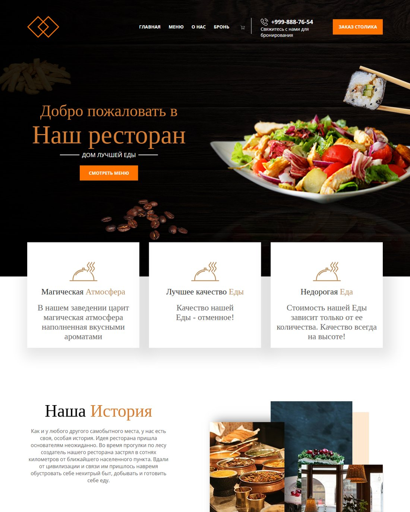

# Ресторан — лендинг ресторана

Адаптивный лендинг ресторана: меню с ценами, бронирование столиков, история заведения, галерея блюд.

**Демо:** [pavelreb.github.io/Restoran](https://pavelreb.github.io/Restoran/)

| Десктоп | Мобильная версия |
|---|---|
|  |  |

## Возможности

- Hero-блок с призывом и кнопкой просмотра меню
- Секция блюд с ценами и кнопками заказа
- Блок «Наша история» со счётчиками (клиенты, блюда, годы работы)
- Галерея блюд
- Адаптивная вёрстка: корректное отображение от мобильных устройств до широких мониторов
- Мобильное меню с контактами

## Стек

HTML5 · CSS3 (Flexbox, медиазапросы) · JavaScript

## Запуск локально

Проект не требует сборки — достаточно открыть `index.html` в браузере или запустить любой статический сервер:

```bash
npx serve .
```

---

# Restoran — Restaurant Landing Page

Responsive restaurant landing page: menu with prices, table reservation, restaurant story and a dish gallery.

**Live demo:** [pavelreb.github.io/Restoran](https://pavelreb.github.io/Restoran/)

## Features

- Hero section with a call-to-action
- Dishes section with prices and order buttons
- "Our story" section with counters (customers, dishes, years)
- Dish gallery
- Responsive layout from mobile to widescreen
- Mobile menu with contacts

## Tech stack

HTML5 · CSS3 (Flexbox, media queries) · JavaScript

## Run locally

No build step required — open `index.html` in a browser or use any static server:

```bash
npx serve .
```
